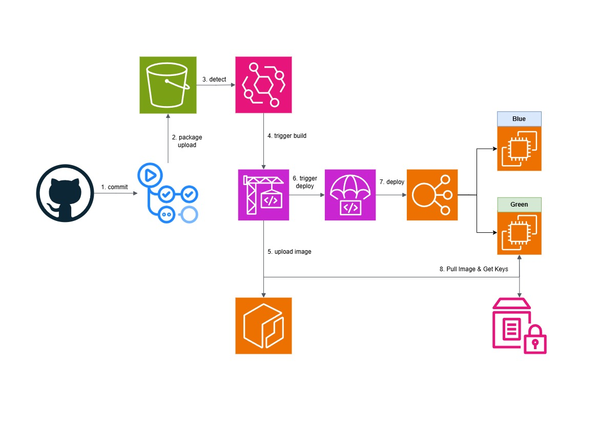

<h1 align=center>CI/CD Backend 파이프라인</h1>
<h3 align="center">서비스를 운영하면서 구축한 파이프라인 아키텍처 입니다.</h3>
  
단순히 편하고 안정적인 배포가 아닌, 영업과 마케팅, 미디어 촬영 작업 등의 시간을 조금이라도 더 벌기 위해 구축하게 되었습니다.

CI/CD 파이프라인 아키텍처와 흐름은 다음과 같습니다.
   

   
1. Github Action에서 소스 파일과 배포 설정 파일(buildspec.yml, appspec.yml)을 패키징하여 S3에 업로드
2. CodePipeline이 S3 업로드를 감지한 후 CodeBuild를 트리거 하여 빌드 및 테스트 진행
3. 빌드 결과물을 ECR에 배포한 뒤 CodeDeploy에서 Blue/Green 전략으로 배포 시작
4. 서버 실행에 필요한 Key들을 Parameter Store에서 바인딩

이를 기반으로 한 CI/CD 배포 전략에 따른 Github Branch 구조입니다.

 

<h3 align=center>deploy-{position}-{statics}</h3>
<h4 align=center>position : app, frontend, backend, fullstack<h4>
<h4 align=center>statics  : default, emergency<h4>

 

backend position에서 default로 배포시 GraalVM 네이티브 이미지로 빌드 및 배포하였으며 emergency, 긴급한 상황일 경우는 빠른 배포를 위해 JIT 컴파일러로 빌드하는 하이브리드 전략으로 상황에 맞게 유연하게 소스를 배포하였습니다.

fullstack의 경우는 frontend와 backend가 함께 빌드 및 배포하게 되는데 앱의 frontend를 배포하고 Cloudfront의 무효화를 진행하여도 일부 사용자의 Cache가 아직 유지되는 것을 확인하였습니다. 이에 따라 사용자 분들의 서비스 제공에 차질이 생기지 않도록 대비하여 마지막 배포 시 Blue/Green 배포 전략에서 Blue 원본 버전을 Cache 유지 시간인 24시간 동안 유지하여 ALB가 사용자가 서버 요청 시 헤더에 포함된 frontend Version을 감지하여 라우팅 되어 24시간이 지난 후에야 Blue가 꺼지는 하이브리드/버전 기반 라우팅 기법으로 배포 전략을 구축하였습니다.