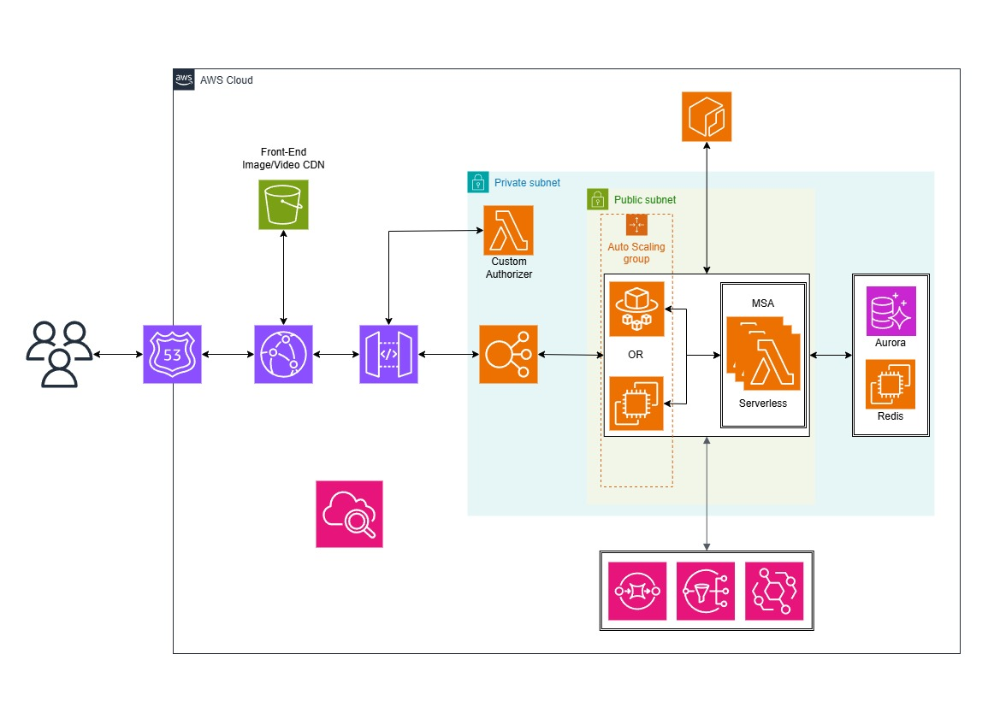

<h1 align="center">안성상회 Architecture</h1>
<h3 align="center">안성상회 서비스에 대한 전체적인 아키텍처입니다.</h3>
  

</img>

  
최대한 서비스 확장과 안정성을 고려하여 설계하여 급작스런 트래픽이 몰려와도 유연하게 Scaling, Routing이 되도록 설계하였지만 15만원이라는 유지비용을 고려하여 설계하였습니다.

API Gateway에 들어오는 대부분의 모든 요청들은 JWT로 클라이언트를 인증/인가 및 토큰 재발급하며, 토큰 형태와 인증 방식을 AES256 암호화 알고리즘을 사용하기에 기본 제공하는 JWT Authorizer으로는 프로세스가 불가능하여 Lambda Custom Authorizer를 구축한 뒤 인증/인가/재발급을 진행하도록 설계하였습니다.

가장 중심에 있는 EC2, Fargate가 저희 안성상회의 메인 서버이며 현재는 아직 모놀리식으로 운영중입니다.
평범한 날의 경우는 EC2 내에서 충분히 돌아가지만 이벤트 프로모션 발표 등 트래픽이 급작스럽게 몰려올 것으로 예상될 땐 Fargate로 잠시 교체하여 운영하였으며 이에 상응하는 Storage 서버 중 DB는 RDS Aurora, Redis는 EC2에 분리하여 운영하였습니다.

모놀리식에서 MSA 아키텍처로 점진적으로 분리한 시스템과 모듈을 주로 Lambda에 배포하여 느슨한 결합 속에서 소통하였고, MSA에서 발생하는 장애 전파와 프로세스 중 발생하는 결함 또는 장애가 다른 시스템에 전파되지 않도록 SQS, EventBridge를 활용하여 대비하였습니다.

메인 서버들은 본래 Private Subnet에 속하여 보안에 철저히 대비하고 NAT Gateway + VPC Endpoint를 결합하여 외부와의 통신을 안전하게 소통하는 것이 베스트지만 비용 문제로 인해 현재는 Public Subnet에 배치하였습니다.